<a id="top"></a>
<div align="center">

<!-- HERO ANIMATED BANNER -->
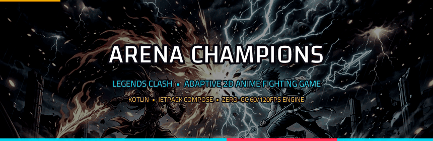

<br />

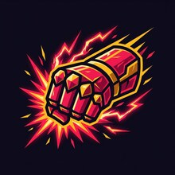

<h1>ARENA CHAMPIONS</h1>
<h3><em>Legends Clash — Adaptive 2D Anime Arcade Fighter</em></h3>

<p>
  <strong>Read your rival. Break their guard. Survive Phase II.</strong><br />
  A native Android 2D fighting game powered by a zero-allocation Jetpack Compose Canvas engine, real-time habit-tracking AI, multi-phase boss battles, and SHA-256 verified progression.
</p>

<!-- STUDIO & TECHNICAL BADGES -->
<p>
  <a href="APK/ArenaChampions.apk">
    
  </a>
  
  
  
  
  
</p>

<!-- QUICK NAVIGATION -->
<p>
  <a href="#-combat--boss-showcases">Combat Showcases</a> •
  <a href="#-core-pillars">Core Pillars</a> •
  <a href="#-playable-fighter-roster">Fighters</a> •
  <a href="#-visual--arenas-gallery">Gallery</a> •
  <a href="#-combat-system--controls">Controls & Frame Data</a> •
  <a href="#-adaptive-ai--difficulty-modes">Adaptive AI</a> •
  <a href="#-8-stage-campaign--boss-rush">Campaign & Bosses</a> •
  <a href="#-download-android-apk">Download APK</a> •
  <a href="#-architecture--build-from-source">Build</a>
</p>

</div>

---

## ✦ Core Pillars

<table>
  <tr>
    <td width="50%" valign="top">
      <h3>⚡ Zero-GC 60/120 FPS Combat Engine</h3>
      <p>
        Built on a fixed-clamped <code>Canvas</code> render loop with pre-allocated <code>FighterRenderScratch</code> paths, gradients, and hit-spark pools — eliminating per-frame GC spikes during explosive hit-stops, directional spark streaks, and dash afterimages.
      </p>
    </td>
    <td width="50%" valign="top">
      <h3>🧠 Real-Time Adaptive AI Brain</h3>
      <p>
        <code>AdaptiveAiBrain</code> profiles your <strong>jump, projectile, guard, and rushdown habits</strong> mid-match using exponential decay weights — dynamically shifting into <em>Anti-Air, Anti-Zoning, Guard Crush, Whiff Punish,</em> and <em>2v1 Flank Pincers</em>.
      </p>
    </td>
  </tr>
  <tr>
    <td width="50%" valign="top">
      <h3>👹 Multi-Phase Boss Encounters</h3>
      <p>
        Challenge <strong>3 distinct Bosses</strong> across an 8-stage Campaign. Dropping a boss below <strong>50% HP</strong> triggers <strong>Phase II Enraged</strong> — unlocking Hyper Armor Seismic Slams, Shadow Blink backstabs, Plasma Barrages, and allied drones.
      </p>
    </td>
    <td width="50%" valign="top">
      <h3>🛡️ SHA-256 Verified Auto-Save</h3>
      <p>
        Continuous DataStore persistence with <strong>salted SHA-256 checksums</strong> and dual primary/backup payloads. Mid-match checkpoints auto-save every 10 seconds and on pause/exit so you can resume right from the exact round, HP, and meter.
      </p>
    </td>
  </tr>
</table>

---

## 🔥 Combat & Boss Showcases

> **Transparency Note on Visual Media:** Builds are compiled and verified in a headless cloud environment without a connected hardware display or emulator. All visuals below are **authentic in-game art assets** shipped inside `res/drawable/`, **official studio anime key art**, and **engine-accurate animated motion diagrams** built directly from the game's frame data and boss state machine — never fabricated device captures.

### 1. Hit-Confirm Chains & Perfect Parry Mechanics *(Engine Flow Diagram)*

<div align="center">
  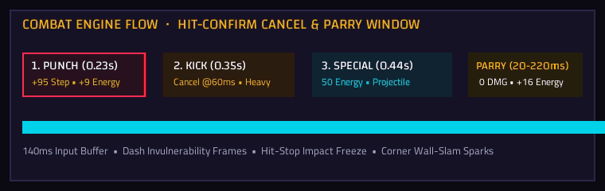
  <p><em>Animated schematic illustrating the 140ms input buffer, Punch → Kick → Special hit-confirm cancel windows, and the 20–220ms Perfect Parry counter window.</em></p>
</div>

### 2. Multi-Phase Boss Enrage & 3-Arena Stage Tour

<table>
  <tr>
    <td width="50%" align="center" valign="top">
      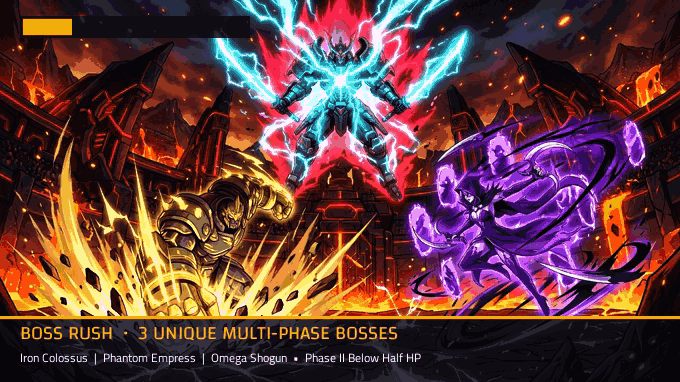
      <br />
      <strong>Official Studio Motion Showcase — Boss Phase II Enrage</strong>
      <br />
      <sub>Below 50% HP, Bosses ignite Phase II with telegraphed warning banners, accelerated cooldowns, and Phase-exclusive super moves.</sub>
    </td>
    <td width="50%" align="center" valign="top">
      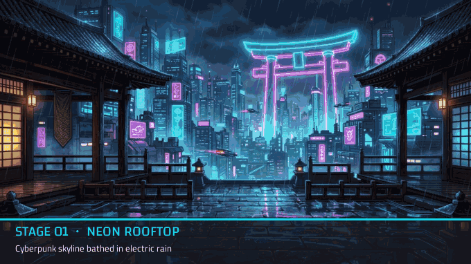
      <br />
      <strong>Real In-Game Stage Art — 3 Fighting Arenas</strong>
      <br />
      <sub>Animated crossfade showcasing the actual <code>img_arena_*</code> battlegrounds rendered behind the Canvas fighter layer.</sub>
    </td>
  </tr>
</table>

---

## ⚔️ Playable Fighter Roster

<div align="center">
  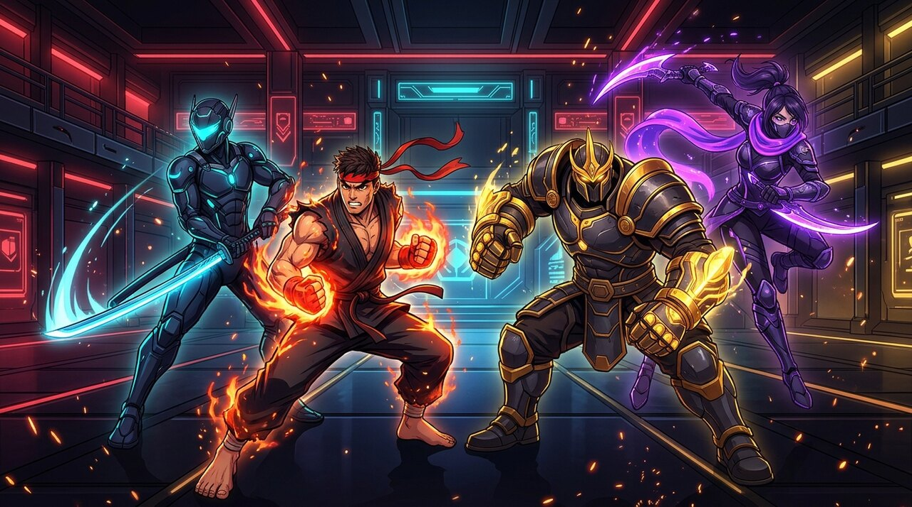
  <p><em>Official Studio Key Art — Left to right: <strong>Saqr</strong> (Crimson Striker), <strong>Saif</strong> (Cyber Ronin), <strong>Jabbar</strong> (Iron Titan), and <strong>Layla</strong> (Shadow Empress).</em></p>
</div>

| Fighter | Epithet | Style | SPD | PWR | DEF | Signature Special (50 Energy) | Unlock Requirement |
| :--- | :--- | :--- | :---: | :---: | :---: | :--- | :--- |
| **Saqr** | Crimson Striker | Martial Artist | `8/10` | `8/10` | `7/10` | **Flame Surge** — Blazing fireball wave across the arena | Starter Unlocked |
| **Saif** | Cyber Ronin | Cyber Ninja | `10/10` | `7/10` | `6/10` | **Volt Slash** — High-velocity electric plasma projectile | Starter Unlocked |
| **Jabbar** | Iron Titan | Heavy Titan | `5/10` | `10/10` | `10/10` | **Earthquake Slam** — Heavy ground shockwave launcher | Clear **Stage 3** or `180 Honor` |
| **Layla** | Shadow Empress | Mystic Assassin | `9/10` | `8/10` | `6/10` | **Shadow Crescents** — Twin piercing dark-energy blades | Clear **Stage 6** or `320 Honor` |

---

## 🎨 Visual & Arenas Gallery

All stage backgrounds and the hero artwork below are **real in-game drawable assets** compiled directly into `APK/ArenaChampions.apk`.

<table>
  <tr>
    <td width="50%" align="center">
      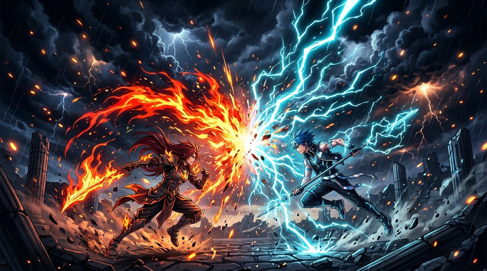
      <br />
      <strong>In-Game Home Hero Banner</strong><br />
      <sub><code>R.drawable.img_hero_clash</code> — Main menu centerpiece framed in gold border.</sub>
    </td>
    <td width="50%" align="center">
      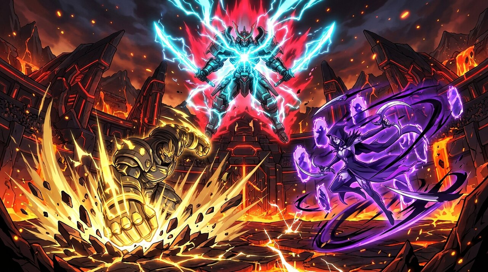
      <br />
      <strong>Official Studio Boss Key Art</strong><br />
      <sub>Iron Colossus Jabbar, Phantom Empress Layla & Omega Shogun Saif.</sub>
    </td>
  </tr>
  <tr>
    <td width="33%" align="center">
      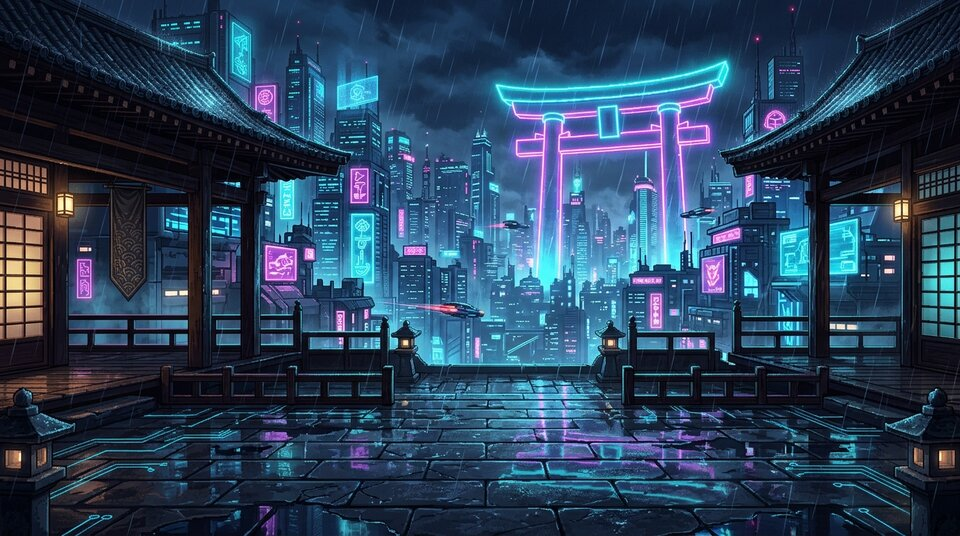
      <br />
      <strong>Neon Rooftop</strong><br />
      <sub><code>img_arena_neon_dojo</code> — Cyberpunk skyline in electric rain.</sub>
    </td>
    <td width="33%" align="center">
      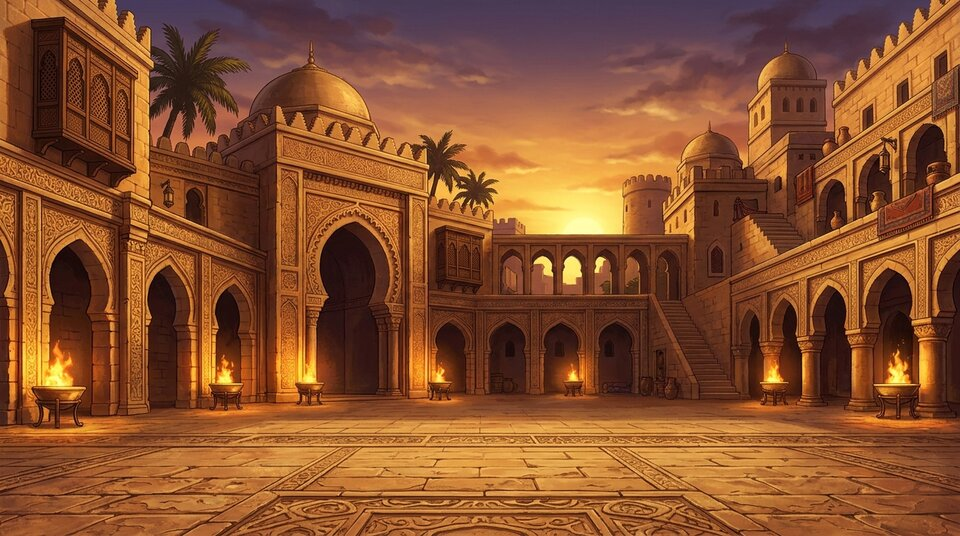
      <br />
      <strong>Desert Citadel</strong><br />
      <sub><code>img_arena_desert_citadel</code> — Ancient sandstone fortress at dusk.</sub>
    </td>
    <td width="33%" align="center">
      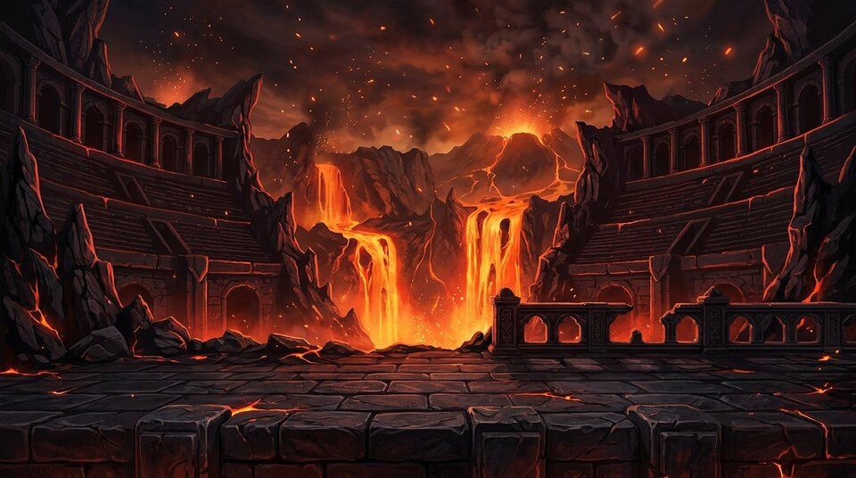
      <br />
      <strong>Volcanic Coliseum</strong><br />
      <sub><code>img_arena_volcanic_forge</code> — Obsidian arena over molten magma.</sub>
    </td>
  </tr>
</table>

---

## 🎮 Combat System & Controls

### Touch Layout & Core Mechanics

* **Dual Ergonomic HUD:** Left-hand directional pad (`Move Left` / `Move Right`) + Jump + Dash; right-hand tactical cluster (`Punch`, `Kick`, `Guard`, `Special`), with optional **Large Touch Controls** mode in Settings.
* **140 ms Input Buffering:** Queues `Punch`, `Kick`, `Special`, `Jump`, and `Dash` inputs slightly before recovery ends so chains stay crisp under pressure.
* **Hit-Confirm Cancel Routes:**
  * `Light Punch (0.23s)` → cancels on hit (`>= 60ms` active) directly into `Heavy Kick (0.35s)`
  * `Heavy Kick (0.35s)` → cancels on hit (`>= 80ms` active) directly into `Special Attack (0.44s)`
* **Perfect Parry (`PARRY!`):** Raising `Guard` within **20 ms – 220 ms** before impact negates **100% of damage (`0 DMG`)**, awards **+16 Energy** (melee) or **+18 Energy** (projectile), triggers a golden shockwave, and grants an ultra-fast `0.06s` counter window. Holding Guard longer still blocks **80%** melee / **75%** projectile damage.
* **Dash Invulnerability & Corner Wall-Slam:** `Dash` (`0.17s` burst, `0.36s` cooldown) grants **140 ms of projectile invulnerability** with translucent afterimages. Heavy knockbacks near arena edges slam opponents off the wall with golden impact sparks.

<details>
<summary><strong>📊 Expand Detailed Move Timing & Armory Perks Reference</strong></summary>

<br />

#### Action Timing & Meter Rules

| Action | Duration | Energy Cost / Gain | Special Properties |
| :--- | :---: | :---: | :--- |
| **Light Punch** | `0.23s` | `+9` on hit | Micro-step forward lunge (`+125 px/s`), fast startup, cancels into Kick |
| **Heavy Kick** | `0.35s` | `+15` on hit | Heavy knockback, corner wall-slam sparks, air dive-kick velocity boost |
| **Special Attack** | `0.44s` | `-50 Energy` | Spawns fighter-specific projectile; HUD button pulses with gold halo when ready |
| **Guard (Hold)** | Hold | `+4` on block | Blocks 80% melee / 75% projectile damage |
| **Perfect Parry** | `20–220ms` window | `+16` / `+18` | `0` damage taken, gold shockwave, `0.06s` instant counter recovery |
| **Dash** | `0.17s` (`0.36s` CD) | Free | `140ms` projectile i-frames + afterimage trail |

#### Unlockable Armory Perks (Equip 1 Active)

| Perk | Cost | Combat Effect |
| :--- | :---: | :--- |
| **Surge Battery** | `100 Honor` | Start every round with **55 Super Energy** and **+20%** meter gain |
| **Iron Bastion** | `140 Honor` | **+12%** max defense and cuts blocked chip damage in **half** |
| **Combo Catalyst** | `180 Honor` | Deals **+15% bonus damage** on combos of 2 hits or more |
| **Phantom Reflex** | `220 Honor` | Cuts dash cooldown by **30%** and boosts movement speed by **+8%** |

</details>

---

## 🧠 Adaptive AI & Difficulty Modes

Unlike static script bots, `AdaptiveAiBrain` maintains live exponentially decaying telemetry of your tendencies (`jumpHabit`, `projectileHabit`, `guardHabit`, `rushHabit`) and updates its tactical posture on the HUD in real time:

| Difficulty Mode | Reaction Cadence | Habit Adaptation | AI Tactical Capabilities |
| :--- | :---: | :---: | :--- |
| **Easy** | `0.36s` | Minimal | Slower reactions, basic spacing, single-hit pokes — built for newcomers |
| **Normal** | `0.19s` | Moderate | Balanced neutral spacing, reactive blocking, and 2-hit `Punch → Kick` confirms |
| **Hard** | `0.095s` | High | Aggressive pressure, anti-airs, dash-through anti-zoning, and whiff punishes |
| **Extreme** | `0.052s` | Maximum | Frame-tight habit reads, guard-crush mixups, corner escapes, and full 3-hit Special chains |

* **Tracked Counter-Tactics:**
  * *Spamming Jumps?* → AI triggers **Anti-Air** upward intercepts.
  * *Spamming Fireballs?* → AI triggers **Anti-Zoning** dash i-frames or jump-ins.
  * *Turtling Behind Guard?* → AI triggers **Guard Crush** jump-over crossups & heavy pressure.
  * *Whiffing Heavy Moves?* → AI dashes in with **Whiff Punish** combo starters.
  * *2v1 Ambush / Boss Stages?* → Coordinates **Pincer Flanks** with an allied striker or aerial drone.

---

## 🗺️ 8-Stage Campaign & Boss Rush

| Stage | Title | Opponent | Arena | Difficulty | Modifier | Reward |
| :---: | :--- | :--- | :--- | :---: | :--- | :---: |
| **01** | Rooftop Initiation | Saif | Neon Rooftop | Easy | Standard Duel | `60 Honor` |
| **02** | Sands of Energy | Saqr | Desert Citadel | Normal | Energy Overcharge (`2x` meter) | `85 Honor` |
| **03** | **Colossus Gate** 👹 | **Iron Colossus Jabbar** | Volcanic Coliseum | Normal | **Armored Boss** (`+35% HP`, Hyper Armor Slam) | `140 Honor` + Unlock Jabbar |
| **04** | Hyper Shadow Duel | Layla | Neon Rooftop | Hard | Hyper Reflex (`+22%` speed) | `120 Honor` |
| **05** | Sandstorm Ambush | Saqr + Ally | Desert Citadel | Hard | **Coordinated Ambush** (`2v1` striker) | `150 Honor` |
| **06** | **Mirror Throne** 👹 | **Phantom Empress Layla** | Neon Rooftop | Hard | **Sudden Impact** (`+35%` crit, `+40% HP`, Shadow Blink + Clone) | `200 Honor` + Unlock Layla |
| **07** | Molten Gauntlet | Jabbar + Ally | Volcanic Coliseum | Extreme | Sudden Impact (`+35%` crit, `2v1` ambush) | `220 Honor` |
| **08** | **Omega Protocol** 👑 | **Omega Shogun Saif** | Volcanic Coliseum | Extreme | **Omega Overdrive** (`+65% HP`, Energy Regen, Plasma Barrage, Aerial Drone) | `350 Honor` |

> **Plus 2 Bonus Modes:** **Quick Versus** (customize any unlocked fighter, opponent, arena, and difficulty) and **Training Dojo** (infinite timer, auto-healing HP, and free Special practice), alongside **4 Missions** and **8 Achievements**.

---

## 📱 Download Android APK

A complete, compiled, and v2-signed Android application package is ready directly inside this repository.

<div align="center">

| Artifact | Value |
| :--- | :--- |
| **Download File** | [**`APK/ArenaChampions.apk`**](APK/ArenaChampions.apk) |
| **Verified File Size** | **`22,701,613 bytes` (~21.65 MB)** |
| **Application ID** | `com.aistudio.arenaclash.qtrmzk` |
| **Version** | `1.0` (`versionCode = 1`) |
| **Compatibility** | Android 7.0+ (`minSdk = 24`, `targetSdk = 36`) |
| **Signing Status** | Verified APK Signature Scheme v2 |

</div>

### Installation Instructions

1. **Direct Device Install:**
   * Download [`APK/ArenaChampions.apk`](APK/ArenaChampions.apk) onto your Android 7.0+ phone or tablet.
   * Open the file from your Downloads manager and allow **Install from unknown sources** if prompted.
2. **ADB Install (Developer / USB Debugging):**
   ```bash
   adb install -r APK/ArenaChampions.apk
   ```

---

## 🏗️ Architecture & Build From Source

### Project Layout

```text
├── APK/
│   └── ArenaChampions.apk               # Verified v2-signed debug APK (22,701,613 bytes)
├── docs/
│   └── assets/                          # README key art, real arena assets & animated GIFs
└── app/src/main/java/com/example/
    ├── MainActivity.kt                  # Edge-to-edge host, lifecycle auto-save & audio/haptics
    ├── audio/
    │   └── SoundEngine.kt               # Pre-allocated MODE_STATIC AudioTrack pool on worker thread
    ├── data/
    │   └── PlayerStatsRepository.kt     # DataStore + salted SHA-256 checksums + backup recovery
    ├── engine/
    │   ├── AdaptiveAiBrain.kt           # Habit telemetry, counter-tactics & boss phase AI
    │   ├── CombatEngine.kt              # Fixed-step physics, hit-confirms, parries & boss patterns
    │   └── FighterRenderer.kt           # Zero-GC cel-shaded Canvas renderer & spark pools
    ├── model/
    │   └── GameModels.kt                # Roster, arenas, 8-stage catalog, perks, missions & state
    ├── ui/
    │   ├── i18n/GameStrings.kt          # Complete English (LTR) & Arabic (RTL) localization
    │   ├── navigation/                  # Type-safe @Serializable Navigation Compose routes
    │   ├── screens/                     # Home, Campaign, Select, Combat, Progression, MoveGuide
    │   └── theme/                       # Material 3 Theme, ColorScheme & custom Changa/Cairo fonts
    └── viewmodel/
        └── GameViewModel.kt             # Coroutine game loop, 10s snapshot auto-save & UI state
```

### Build & Test Commands

```bash
# Build debug APK
gradle :app:assembleDebug

# Run core combat physics, parry & save-integrity unit tests
gradle :app:testDebugUnitTest --tests "com.example.CombatEngineTest" --tests "com.example.ExampleUnitTest"
```

---

<div align="center">

<!-- ANIMATED STUDIO FOOTER -->
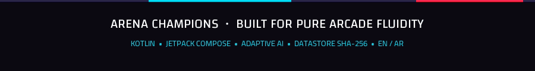

<p>
  <strong>Arena Champions</strong> • Built with Kotlin, Jetpack Compose, and Canvas 2D<br />
  <a href="APK/ArenaChampions.apk">Download v1.0 APK (21.65 MB)</a> • <a href="#top">Back to Top ↑</a>
</p>

</div>
